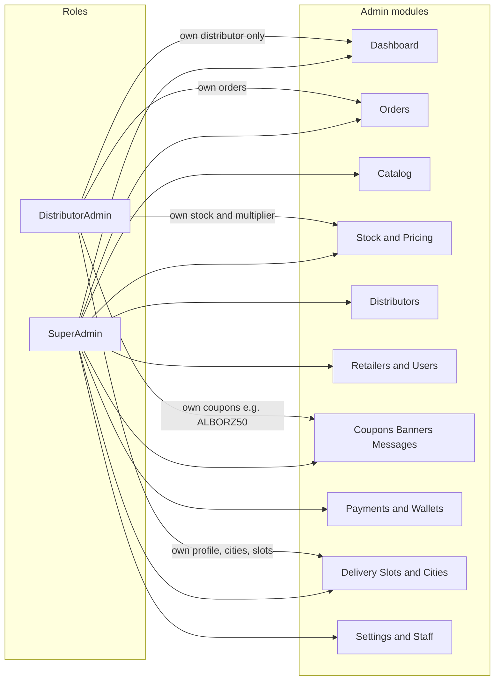

# Visitor Admin Panel — Build Plan

> Project memory for `admin-FrontEnd/`. Read this before making architectural changes.
> Sibling app: `../FrontEnd` (client/retailer PWA). Live demo: https://visitor-pwa-three.vercel.app (phone `09143662051`, OTP `12345`).

**Status:** planning approved, scaffold not started.
**Decisions locked (2026-09-20):**

- Roles: two — platform **SuperAdmin** + **DistributorAdmin** (scoped to its own شرکت پخش).
- Stack: same as client — Vite + React 19 + TypeScript + Tailwind v4 + shadcn (radix-nova, rtl) + Zustand + react-router v7. Standalone folder (no monorepo); domain types and mock-API pattern copied/adapted from the client.

---

## 1. What exists in the client app (`../FrontEnd`)

**Product**: ویزیتور — a wholesale (carton-based) ordering PWA for shop owners (retailers) buying from distribution companies (شرکت پخش). One cart = one distributor; `MIN_ORDER` = 500,000 تومان; Jalali delivery slots; wallet + gateway payments; coupons; OTP login.

**Stack** (`FrontEnd/package.json`): Vite 8, React 19, TypeScript strict, Tailwind v4 (`@tailwindcss/vite`), shadcn `radix-nova` style with `rtl: true` (`FrontEnd/components.json`), `radix-ui`, `lucide-react`, `motion`, Zustand 5 (persist), react-router-dom 7, vitest + testing-library, oxfmt, deployed to Vercel as SPA (`FrontEnd/vercel.json`).

**Architecture**:

- `src/services/api.ts` defines a `VisitorApi` interface; `src/services/mockApi.ts` implements it over `localStorage` (`visitor:db:v1`); `src/services/client.ts` is the swap point (`VITE_API_MODE=mock|http`).
- `src/store/useAppStore.ts` — single Zustand store (session, cart, addresses, orders, wallet, theme, toast).
- `src/data/catalog.ts` — static `DISTRIBUTORS` (8), `PRODUCTS` (16), `DISTRIBUTOR_STOCK` (per-distributor product ids), banners, categories. `src/data/account.ts` — coupons, gift cards, messages, FAQs.
- `src/types/index.ts` — the domain model (User, Product, Distributor, Order, Address, WalletTransaction, PendingPayment, …).

**Design language** (`FrontEnd/AGENTS.md`, `src/index.css`): RTL Persian, IRANSansXFaNum with Farsi numerals, Apple HIG semantic colors (grouped bg `#F2F2F7`/`#000`, cards `#FFF`/`#1C1C1E`, label primary/secondary/tertiary, fills, separators), monochrome accent (black/white), red only for deals/destructive, theme via `data-theme` on `<html>`, `--radius: 0.625rem`, shadcn CSS variables already mapped (incl. `--sidebar-*` and `--chart-*`).

**Gaps the admin must fill**: the client has no admin-side concepts — no product CRUD, no stock/price management per distributor, no order state transitions (only `current | delivered | cancelled`), no user/retailer management, no coupon/banner authoring, no analytics. All data is static or localStorage today.

---

## 2. Design model

### 2.1 Roles and scoping



- **SuperAdmin** (platform operator): global view; can impersonate / "act as" a distributor for support.
- **DistributorAdmin**: every query is scoped by `session.distributorId`. Route guard `RequireRole` + a `scope` helper in the API layer so scoping is enforced in one place, not per page.
- Permission model: `role` + `permissions: Permission[]` on the session, checked by a `can(perm)` hook and a `<Can perm="orders.update">` component. Sidebar items declare their required permission and self-hide.

### 2.2 Information architecture (routes)

| Route                                                             | Purpose                                                                                                                                                                                                               |
| ----------------------------------------------------------------- | --------------------------------------------------------------------------------------------------------------------------------------------------------------------------------------------------------------------- |
| `/login` → `/otp`                                                 | Same OTP flow as client (`09143662051` / `12345`); demo buttons for both roles                                                                                                                                        |
| `/`                                                               | Dashboard — KPI cards (GMV today/7d/30d, orders by status, active retailers, top distributors), orders trend chart, low-stock alerts, recent orders                                                                   |
| `/orders`, `/orders/:id`                                          | Filterable table (status, distributor, city, Jalali date range); detail with timeline and **status transitions** `pending → confirmed → packing → shipped → delivered \| cancelled` (superset of client's 3 statuses) |
| `/products`, `/products/new`, `/products/:id`                     | Catalog CRUD (name, brand, category/subCategory, sku, unitsPerCarton, minOrderQty, base price, image); CSV import stub                                                                                                |
| `/stock`                                                          | Distributor × product matrix: available toggle, per-product price override, `priceMultiplier`; bulk actions (DA sees own row only)                                                                                    |
| `/distributors`, `/distributors/:id`                              | Profile, cities served, `status active\|full`, deliveryMins, deliveryFee, minBasket, rating, pro flag, staff accounts                                                                                                 |
| `/retailers`, `/retailers/:id`                                    | Shop owners (client `User`), addresses on a Leaflet map, order history, wallet balance, block/unblock, primary distributor, retailer Pro plan + subscription history                                                                                                                 |
| `/marketing/coupons`, `/marketing/banners`, `/marketing/messages` | Coupon rules (percent/fixed, min total, distributor restriction, expiry); home banner ordering; inbox messages (`order\|promo\|stock`)                                                                                |
| `/finance/payments`, `/finance/wallets`, `/finance/subscriptions` | Payments ledger, wallet top-ups, manual adjustment with reason; SuperAdmin retailer Pro subscriptions and revenue                                                                                                                                                        |
| `/delivery/slots`, `/delivery/cities`                             | Slot windows (09:45–18:45, 30-min steps), holidays, cities list                                                                                                                                                       |
| `/drivers`, `/drivers/:id`, `/deliveries`                         | Driver accounts (tenant-scoped), today's route per driver, delivery activity; verification queue where an admin confirms (order → delivered) or rejects a driver-submitted, backend-validated delivery code |
| `/settings/general`, `/settings/staff`, `/settings/audit-log`     | Platform settings, staff accounts, audit trail                                                                                                                                                                        |
| `*`                                                               | 404                                                                                                                                                                                                                   |

### 2.3 Layout and UI system

- **Desktop-first** (min 1024px), responsive down to tablet; on mobile the sidebar collapses into a sheet.
- shadcn **Sidebar** (right side, RTL) + top bar (⌘K command palette, theme toggle, distributor switcher for SA, avatar menu). Uses the `--sidebar-*` tokens already present in the client's `index.css`.
- Reuse client tokens verbatim (`index.css` copied minus leaflet/PWA-specific bits) so both apps read as one product; monochrome accent, red only for destructive/alerts. Charts use the `--chart-1..5` gray ramp (one restrained data accent may be added).
- shadcn building blocks: `sidebar`, `table` + TanStack Table (`DataTable` with column visibility, sort, pagination, RTL-aware), `sheet`/`dialog` for edit forms, `form` + `react-hook-form` + `zod`, `command`, `badge`, `tabs`, `dropdown-menu`, `sonner`, `skeleton`, `chart` (Recharts).
- Shared primitives: `PageHeader` (title, breadcrumb, actions), `StatCard`, `StatusBadge`, `Price` (Farsi numerals via ported `format.ts`), `JalaliDatePicker` (ported `JalaliCalendar.tsx`), `EmptyState`, `ConfirmDialog`.

### 2.4 Data layer

- `src/services/api.ts` → `AdminApi` interface (auth, dashboard, orders, products, stock, distributors, retailers, coupons, banners, messages, payments, wallets, slots, cities, staff, audit).
- `src/services/mockApi.ts` → localStorage (`visitor-admin:db:v1`) seeded from a **copy of the client's `catalog.ts` / `account.ts` / demo orders** so admin and client show the same demo world. `src/services/client.ts` picks mock vs http via `VITE_API_MODE`.
- **TanStack Query** for server state (cache, invalidation, optimistic status updates); Zustand only for session, UI prefs (theme, sidebar collapsed), toasts. Intentionally different from the client's Zustand-only approach: admin tables/filters need caching and pagination.
- Types: `src/types/index.ts` is a **superset** of the client's file (same shapes + admin-only: `Staff`, `Permission`, `AuditEntry`, `StockEntry`, `Coupon`, `Banner`, `DeliverySlotConfig`, extended `OrderStatus`, `OrderEvent`). Header comment: `// keep in sync with ../FrontEnd/src/types/index.ts`. When a real backend arrives, both apps consume its OpenAPI types.

### 2.5 Conventions carried over from the client

- Default-export pages and layout components; `@/` alias; Tailwind utilities with tokens in `index.css`; RTL Persian copy; Farsi numerals everywhere; tests colocated (`*.test.ts`) with vitest + jsdom; `pnpm`; Vercel SPA rewrite. Formatter: Prettier (the client's oxfmt 0.2.x corrupts inline object types — see AGENTS.md).
- `AGENTS.md` in this folder documents the relationship to `../FrontEnd`, roles, and the "types superset" rule.

---

## 3. Project tree

```text
admin-FrontEnd/
├── AGENTS.md
├── docs/
│   └── BUILD_PLAN.md               # this file
├── index.html                      # lang="fa" dir="rtl", theme bootstrap script (from client)
├── package.json                    # visitor-admin; dev/build/preview/typecheck/test/format
├── pnpm-lock.yaml
├── tsconfig.json                   # same as client (@/* alias, strict)
├── vite.config.ts                  # react + tailwindcss + alias; port 8444; vitest jsdom (no PWA/figma plugins)
├── vercel.json                     # SPA rewrite
├── components.json                 # shadcn radix-nova, rtl: true, baseColor neutral
├── .env.example                    # VITE_API_MODE=mock, VITE_API_BASE_URL=
├── .gitignore
├── public/
│   ├── favicon.svg
│   ├── fonts/IRANSansXFaNum-*.ttf  # copied from client
│   └── images/                     # demo product images (copied subset)
└── src/
    ├── main.tsx
    ├── App.tsx                     # router + providers (QueryClient, Theme, Toaster)
    ├── index.css                   # client tokens + sidebar/chart vars; desktop body (no overflow lock)
    ├── vite-env.d.ts
    ├── routes/
    │   ├── router.tsx              # createBrowserRouter tree
    │   ├── paths.ts                # typed route path constants
    │   └── guards/
    │       ├── RequireAuth.tsx
    │       └── RequireRole.tsx     # role/permission gate
    ├── layouts/
    │   ├── AuthLayout.tsx          # centered card (login/otp)
    │   ├── AdminLayout.tsx         # Sidebar + Topbar + <Outlet/>
    │   ├── Sidebar.tsx             # nav config → shadcn sidebar, permission-aware
    │   └── Topbar.tsx              # breadcrumb, ⌘K, distributor switcher, theme, user menu
    ├── pages/
    │   ├── auth/
    │   │   ├── LoginPage.tsx
    │   │   └── OtpPage.tsx
    │   ├── dashboard/
    │   │   ├── DashboardPage.tsx
    │   │   └── components/         # KpiGrid, OrdersTrendChart, LowStockList, RecentOrders
    │   ├── orders/
    │   │   ├── OrdersPage.tsx
    │   │   ├── OrderDetailPage.tsx
    │   │   └── components/         # OrdersTable, OrderFilters, OrderTimeline, StatusTransitionMenu
    │   ├── products/
    │   │   ├── ProductsPage.tsx
    │   │   ├── ProductFormPage.tsx # new + edit
    │   │   └── components/         # ProductsTable, ProductForm, CategoryPicker
    │   ├── stock/
    │   │   ├── StockPage.tsx       # distributor × product matrix
    │   │   └── components/         # StockMatrix, PriceOverrideCell, BulkActionsBar
    │   ├── distributors/
    │   │   ├── DistributorsPage.tsx
    │   │   ├── DistributorDetailPage.tsx
    │   │   └── components/         # DistributorForm, CitiesMultiSelect, StaffList
    │   ├── retailers/
    │   │   ├── RetailersPage.tsx
    │   │   ├── RetailerDetailPage.tsx
    │   │   └── components/         # AddressesMap (leaflet), RetailerOrders, WalletSummary
    │   ├── marketing/
    │   │   ├── CouponsPage.tsx
    │   │   ├── BannersPage.tsx
    │   │   ├── MessagesPage.tsx
    │   │   └── components/         # CouponForm, BannerSortableList, MessageComposer
    │   ├── finance/
    │   │   ├── PaymentsPage.tsx
    │   │   ├── WalletsPage.tsx
    │   │   └── components/         # LedgerTable, AdjustBalanceDialog
    │   ├── delivery/
    │   │   ├── SlotsPage.tsx
    │   │   └── CitiesPage.tsx
    │   ├── settings/
    │   │   ├── GeneralPage.tsx
    │   │   ├── StaffPage.tsx
    │   │   └── AuditLogPage.tsx
    │   └── NotFoundPage.tsx
    ├── components/
    │   ├── ui/                     # shadcn generated: button, input, table, sidebar, sheet, dialog,
    │   │                           # dropdown-menu, badge, tabs, command, form, select, switch,
    │   │                           # skeleton, tooltip, chart, sonner, ...
    │   ├── data-table/
    │   │   ├── DataTable.tsx       # TanStack Table wrapper (RTL, sort, pagination, column toggle)
    │   │   ├── DataTableToolbar.tsx
    │   │   └── DataTablePagination.tsx
    │   ├── shared/
    │   │   ├── PageHeader.tsx
    │   │   ├── StatCard.tsx
    │   │   ├── StatusBadge.tsx
    │   │   ├── Price.tsx
    │   │   ├── EmptyState.tsx
    │   │   ├── ConfirmDialog.tsx
    │   │   ├── ThemeToggle.tsx
    │   │   ├── VisitorLogo.tsx     # copied from client
    │   │   └── Can.tsx             # permission wrapper
    │   └── jalali/
    │       ├── JalaliCalendar.tsx  # ported from client checkout
    │       └── JalaliDatePicker.tsx
    ├── features/                   # TanStack Query hooks per domain (thin, typed)
    │   ├── auth/useSession.ts
    │   ├── orders/useOrders.ts
    │   ├── products/useProducts.ts
    │   ├── stock/useStock.ts
    │   ├── distributors/useDistributors.ts
    │   ├── retailers/useRetailers.ts
    │   ├── marketing/useCoupons.ts, useBanners.ts, useMessages.ts
    │   ├── finance/usePayments.ts, useWallets.ts
    │   ├── delivery/useSlots.ts, useCities.ts
    │   └── settings/useStaff.ts, useAuditLog.ts
    ├── services/
    │   ├── api.ts                  # AdminApi interface + ApiOk/ApiError
    │   ├── client.ts               # mock | http switch
    │   ├── mockApi.ts              # localStorage impl (visitor-admin:db:v1), role scoping
    │   ├── httpApi.ts              # fetch-based impl stub for future backend
    │   └── seed/
    │       ├── catalog.ts          # copied from ../FrontEnd/src/data/catalog.ts
    │       ├── account.ts          # coupons / gifts / messages
    │       ├── cities.ts
    │       ├── orders.ts           # richer demo orders across distributors & statuses
    │       └── staff.ts            # demo super-admin + distributor admin accounts
    ├── store/
    │   ├── useSessionStore.ts      # Zustand persist: session, role, activeDistributorId
    │   └── useUiStore.ts           # theme, sidebar collapsed, table density
    ├── lib/
    │   ├── utils.ts                # cn
    │   ├── format.ts               # toFaNum, formatPrice, createId (ported)
    │   ├── phone.ts                # ported + tests
    │   ├── jalali.ts               # ported from client delivery.ts
    │   ├── permissions.ts          # Role → Permission[] map, can()
    │   ├── orderStatus.ts          # transitions graph + labels + client-status mapping
    │   ├── theme.ts                # ported
    │   ├── csv.ts                  # export table → CSV
    │   └── *.test.ts
    ├── types/
    │   └── index.ts                # superset of ../FrontEnd/src/types/index.ts
    └── test/
        └── setup.ts
```

---

## 4. Build order (phases)

| #   | Phase                                                                                                                                                                                                                                                                                                                | Status  |
| --- | -------------------------------------------------------------------------------------------------------------------------------------------------------------------------------------------------------------------------------------------------------------------------------------------------------------------- | ------- |
| 1   | **Scaffold** — Vite + Tailwind v4 + shadcn (rtl); tokens/fonts/favicon/index.html theme bootstrap copied from client; `AGENTS.md`; `git init`; router skeleton with `AdminLayout` + Sidebar + auth pages; `types`, `permissions`, stores, TanStack Query provider, `AdminApi` + mock seed; demo login for both roles | ✅ done |
| 2   | **Dashboard + Orders** — KPIs/charts; orders table, filters, detail, status-transition workflow                                                                                                                                                                                                                      | ✅ done |
| 3   | **Catalog** — Products CRUD, Stock matrix (distributor × product, price overrides), Distributors CRUD                                                                                                                                                                                                                | ✅ done |
| 4   | **Retailers + Marketing** — retailers list/detail with Leaflet map; coupons, banners, messages                                                                                                                                                                                                                       | ✅ done |
| 5   | **Finance + Delivery + Settings** — payments/wallets ledger, delivery slots & cities, general/staff/audit log; tests, oxfmt, Vercel config                                                                                                                                                                           | ✅ done |
| 6   | **SaaS retailer plan** — primary distributor on retailers, retailer Pro subscriptions (super_admin), subscriptions ledger, `proMonthlyPrice` in settings. Unrelated to `distributors.pro`.                                                                                                                          | ✅ done |
| 7   | **Drivers & delivery confirmation** (2026-09-27, mock API only) — `/drivers`, `/drivers/:id` (create/edit/activate, reset password, today's route reorder + dispatch, activity), `/deliveries` verification queue, driver column + filter in Orders, delivery card + confirm/reject in Order detail, bell popover for "delivery verification received". Perms `drivers.view/manage`, `deliveries.assign/confirm`. Driver-bound orders can't be marked delivered manually. Spec: `../Driver-FrontEnd/docs/DRIVER_DESIGN_PROPOSAL.md`. | ✅ done (front end) |

Note: `admin-FrontEnd/` had no git repo when this plan was written; phase 1 initialized it as a standalone repo (mirrors the client's setup).

### Verification (2026-09-20)

- `pnpm typecheck` — clean.
- `pnpm build` — production bundle OK (route chunks lazy-loaded).
- `pnpm test` — 30 tests: `orderStatus`, `jalali`, and `src/test/pages.smoke.test.tsx`, which mounts **every route** in jsdom as SuperAdmin via a memory router, plus 404, unauthenticated redirect, and DistributorAdmin `RequireRole` denial.
- Manual smoke in the Cursor browser on `localhost:8444`: login (demo buttons + OTP), dashboard, orders, order detail; responsive sidebar sheet at narrow widths.

### Known follow-ups

- `services/httpApi.ts` is a stub; switch `services/client.ts` when the backend exists (`VITE_API_MODE=http`).
- Banners have no image upload yet (URL input only).
- No i18n layer — all copy is inline Persian, same as the client.

---

## 5. Demo accounts (mock mode)

| Role             | Phone                                        | OTP     | Scope                |
| ---------------- | -------------------------------------------- | ------- | -------------------- |
| SuperAdmin       | `09143662051`                                | `12345` | all distributors     |
| DistributorAdmin | `09121234567` (سارا محمدی, distributor `d2`) | `12345` | own distributor only |

The login page also has one-click demo buttons for both roles. Demo data lives in `localStorage` under `visitor-admin:db:v1`; reset it from Settings → General or the sidebar user menu.
