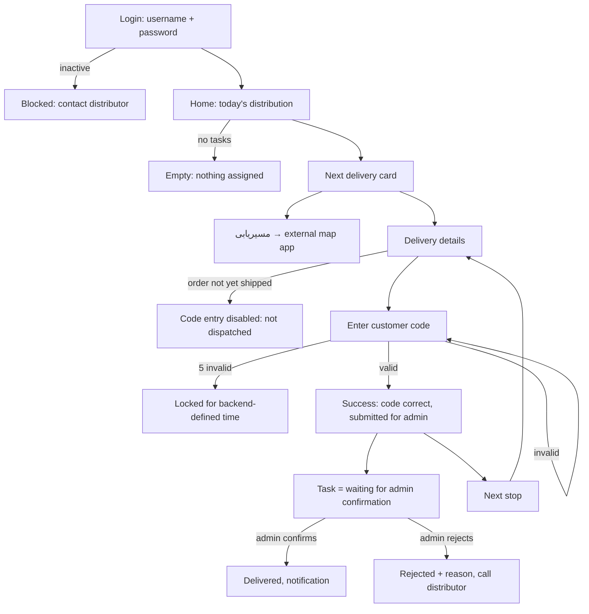
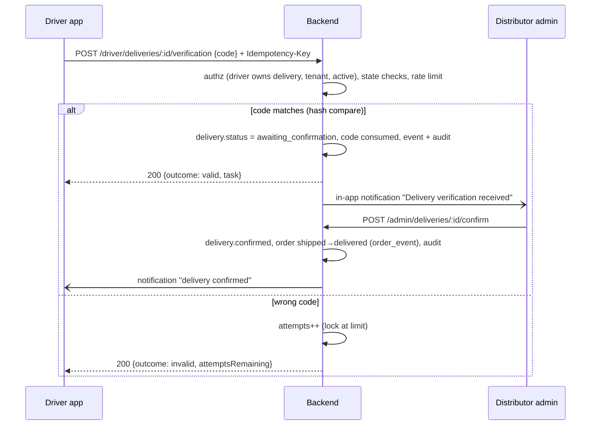
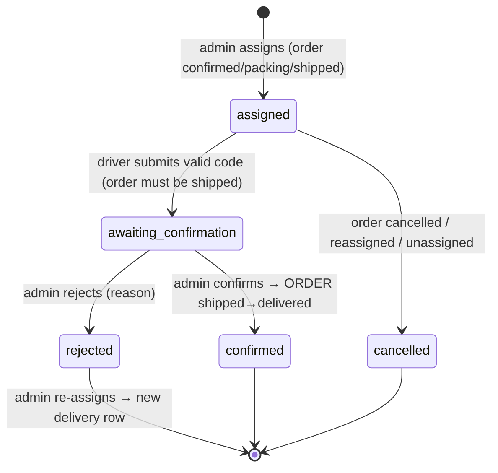

# V-Project — Driver Application & Admin Extensions

**Design + product specification, with a working front-end prototype.** Date: 2026-09-27.
Status: **PROPOSED**. The product owner requested this design and the front-end build. It is not an approved ADR and does not change the priority-0 master flow (see §0).

| What | Where | Evidence class |
| --- | --- | --- |
| Driver PWA (mock API, 11 screens) | `Driver-FrontEnd/` | CODE_VERIFIED: typecheck clean, 21 tests pass |
| Admin extensions (drivers, assignment, confirmation, notifications) | `admin-FrontEnd/` | CODE_VERIFIED: typecheck clean, 46 tests pass (32 existing + 14 new) |
| Backend driver/delivery endpoints | **not built** (spec only, §17–§19) | PROPOSED |
| Client PWA delivery-code display | **not built** (spec only, §17.6) | PROPOSED |
| Screenshots | `Driver-FrontEnd/docs/preview/` | captured from the running mock build |

Sources reconciled: the priority-0 flow (`V-Project-AI-Workspace/docs/references/2026-09-25-owner-supplied/flow.txt`), `MASTER_FLOW_CONTRACT.md`, `AI_CONTEXT/00–12`, `REFERENCE_RECONCILIATION.md` (C-1…C-6), ADR-001…008, `admin-FrontEnd/docs/BUILD_PLAN.md` and source, `FrontEnd/` source, and `backend/src` (schema, `order-status.ts`, `permissions.ts`).

---

## 0. Reconciliation and conflicts (read first)

The following conflicts are **recorded, not silently resolved**:

| ID | Conflict | Sources | Treatment in this design |
| --- | --- | --- | --- |
| **C-7 (new)** | **Who makes an order DELIVERED.** The approved flow has `DRIVER_APP → DELIVERED_ACTION "Tap Delivered" → DELIVERY_SERVICE → ORDER_SERVICE`, and its complete business flow ends `DRIVER_APP → DELIVERED_ACTION → DELIVERED`. The 2026-09-27 brief says the driver only submits a customer delivery code, the backend validates it, and **only an admin confirmation** makes the order DELIVERED. | flow.txt lines 491–500, 515–521, 1104–1116; this brief §3 | The brief is implemented. The flow's bytes are unchanged. **The owner must approve a new dated flow version**, or confirm that the brief supersedes these edges (the governance rule is that only ADR-002→007 is auto-superseded). |
| C-5 (existing) | **Order-state set.** The flow has pending/confirmed/processing/ready/out-for-delivery/delivered/cancelled/delivery-failed/rescheduled. The code has `awaiting_payment/pending/confirmed/packing/shipped/delivered/cancelled`. | `backend/src/lib/order-status.ts`, admin `lib/orderStatus.ts` | **No new order states were added.** Delivery progress lives in a separate *delivery* status (§7). `shipped` ("ارسال شده") is used as the flow's *Out for Delivery*. `delivery_failed` and `rescheduled` are not implemented (OQ-3). |
| C-3 (existing) | Driver/route UI was reported as built, but the code had none. | 2026-09-27 audit | Now designed. The front end is built with mocks; the backend is still absent. |
| D-1 | **Manual "ثبت تحویل".** The admin can move `shipped → delivered` without any driver, which contradicts "only after confirmation". | admin `OrderDetailPage` (existing behaviour) | Kept **only for orders with no driver**, to preserve existing working UI. It is blocked in the UI and in the mock API for driver-bound orders. Whether to remove it entirely is OQ-1. |
| D-2 | **Credential model.** Staff and retailers log in with phone + OTP; the brief asks for a driver username + password created by the admin. | `backend/src/modules/auth.ts`, `otp_codes` | A new credential type. The backend needs password hashing, lockout and a `driver` subject in `refresh_tokens.subjectType` (§17.1). Implemented as the brief says; OQ-6 asks whether OTP should also be allowed. |
| D-3 | **Notifications recipient.** `notifications` rows have `retailer_id NOT NULL`. | `backend/src/db/schema/marketing.ts` | Needs a recipient type (retailer / driver / staff) or separate tables (§19). |
| D-4 | Admin `OrderStatus` lacks the backend's `awaiting_payment`. | admin `types/index.ts` vs backend | Pre-existing drift. Not changed here; flagged for type sync. |
| D-5 | **Sequencing vs roadmap.** Driver work is milestone **M2**, after M1 backend hardening (SEC-001 etc.), and awaits owner decision D-2 (first-release scope). | `AI_CONTEXT/07_ROADMAP.md` | Front end only; no backend was touched. The owner's request is treated as the D-2 signal for *design*. Release scope is still the owner's decision. |

Fixes made along the way:
- The admin mock's `seedDb()` returned the seed arrays by reference, so "reset demo data" never really reset them. It now deep-clones.
- The driver app uses the Persian comma "،" as its separator instead of "·", which is visually identical to Persian zero "۰" next to digits. The admin's existing screens still use "·" (not changed; see OQ-14).

---

## 1. Driver product vision

**A field tool for distributor drivers that answers one question: "What do I deliver next, and how do I prove I delivered it?"**

- **User:** a distribution-company driver. They are outdoors, often using one hand, on a mid-range Android phone with patchy connectivity. They are not an admin, a marketplace user, or a logistics analyst.
- **Loop:** SEE → GO → DELIVER → ENTER CODE → WAIT FOR CONFIRMATION → NEXT.
- **Proof of delivery:** a code that only the shop owner has. The backend validates it; a distributor admin confirms it. The driver never marks an order delivered.
- **Non-goals (MVP):** live GPS, route optimization, turn-by-turn navigation, payments or cash collection, performance analytics, and chat.
- **Family resemblance:** the same ویزیتور wordmark, IRANSansXFaNum, Apple HIG grouped surfaces and monochrome accent as the client PWA and admin panel. It is "another V-Project app".

## 2. Driver user flows

### 2.1 Daily loop



### 2.2 Code submission (driver ↔ backend ↔ admin)



### 2.3 Admin flows

1. **Create driver:** Drivers → راننده جدید → name, mobile, username, optional vehicle and plate, initial password (auto-generated) → the credentials are shown **once** with a copy button.
2. **Assign:** Orders → «راننده» column (or Order detail → Delivery card) → pick an **active driver of the order's own distributor** → the driver's route gets a new stop and the driver is notified.
3. **Dispatch:** Driver detail → «ثبت ارسال N سفارش آماده». This moves that route's `packing` orders to `shipped`, which enables code entry.
4. **Review:** bell popover, «تایید تحویل‌ها» queue, or Order detail → «تایید تحویل» (confirm dialog) or «رد» (required reason).
5. **Account:** edit, reset password (new random password shown once), activate or deactivate.

## 3. Driver screen map

| # | Route | Screen | Key states |
| --- | --- | --- | --- |
| 1 | `/login` | Login | error (invalid, inactive, locked, offline); session-expired/deactivated banner; demo guide (mock only) |
| 2 | `/` | **Home / Today's distribution**: greeting, Jalali date, summary (total, delivered, awaiting, remaining), important unread notifications, **Next delivery** card, route preview | loading skeleton; empty "no assignment"; all-submitted; all-confirmed; error + retry |
| 3 | `/route` | Today's route: ordered stops as a timeline, next stop emphasized; "removed from route" section | loading; empty; error |
| 4 | `/tasks/:id` | **Delivery details**: shop, address, time, navigate, call, instructions, order summary (items and cartons, no prices), verification panel, sticky **ثبت کد تحویل** | ready; not dispatched; waiting; confirmed; rejected (with reason); order cancelled; reassigned; locked; old (read-only) task; not found; "status just changed" banner |
| 5 | `/tasks/:id/code` | **Delivery code entry**: segmented numeric input (length from the backend) and the explicit primary action | idle; verifying; invalid (+ attempts left); locked (+ until time); offline (not sent); timeout (unknown → «بررسی وضعیت»); closed outcomes |
| 6 | (same) | **Code verification success**: «کد تحویل صحیح است.» then «تحویل برای تأیید مدیر ثبت شد.», waiting chip, go to next stop | — |
| 7 | `/tasks/:id` | **Waiting for admin confirmation**: an inverted panel, no action needed | — |
| 8 | `/tasks/:id/code` | **Invalid code**: «کد تحویل صحیح نیست.» The code is never revealed | — |
| 9 | `/history` | Delivery history grouped by day, with filters (all, confirmed, awaiting, rejected, cancelled/reassigned) | empty per filter |
| 10 | `/notifications` | Notifications: unread dot, tap to open the task, mark all read | empty |
| 11 | `/profile` | Profile: name, driver ID, mobile, distributor (call), vehicle and plate, dark mode, logout; "ask your admin to change the password" | — |
| — | `*` | 404 | — |

Tabs: امروز · مسیر · تاریخچه · پروفایل. Notifications open from the bell on the tab headers.

## 4. Admin changes

| Area | Change | Files |
| --- | --- | --- |
| Navigation | New «ارسال» items: **تایید تحویل‌ها** (with a pending badge) and **رانندگان** | `routes/nav.ts`, `layouts/Sidebar.tsx` |
| Drivers list | `/drivers`: KPI cards (active drivers, today's orders, confirmed, awaiting you), search, active/inactive filter, table (driver and username, mobile, distributor for SuperAdmin, vehicle, today's progress bar with awaiting badge, last login, status) | `pages/drivers/DriversPage.tsx` |
| Create / edit driver | Dialog: name, mobile, **username (globally unique)**, distributor (SuperAdmin without scope only), vehicle and plate, initial password (generated, shown once), active switch | `pages/drivers/components/DriverFormDialog.tsx` |
| Driver status | Activate/deactivate with a confirm dialog explaining the effect; reset password → new credentials dialog | `pages/drivers/DriverDetailPage.tsx` |
| Driver activity | `/drivers/:id`: today's route with **reorder ↑↓**, order and delivery badges, inline confirm/reject, failed-attempt count, **dispatch** button, removed stops; delivery activity table | same |
| Assignment in Orders | «راننده» column with a **validated select** (only active drivers of that order's distributor; locked with a tooltip when not assignable); a "کد ثبت شد" or "تحویل رد شد" badge; «فیلتر راننده» (all / unassigned / awaiting / a driver); CSV gets a driver column | `pages/orders/OrdersPage.tsx`, `components/delivery/DriverSelect.tsx` |
| Order detail | Delivery card: driver select, stop number, verification time and driver, confirmation and confirmer, rejection reason, assignment history. The header shows «تایید تحویل / رد» when awaiting, or «منتظر کد تحویل راننده» instead of the manual «ثبت تحویل». A mock-only simulate action is in the ⋯ menu | `pages/orders/OrderDetailPage.tsx` |
| Verification notification | The top-bar bell is now a popover: "تایید کد تحویل دریافت شد" with shop, order, driver, کد تحویل: معتبر, time, and inline **[تایید تحویل] / [رد]**. The pending-orders shortcut is kept | `layouts/NotificationsPopover.tsx` |
| Delivery confirmation | `/deliveries`: queue cards (awaiting), plus today/all tables with who decided and when | `pages/deliveries/DeliveriesPage.tsx`, `components/delivery/DeliveryDecision.tsx` |

Unrelated admin sections were not redesigned.

## 5. Driver role and permissions

**New role `driver`**, a separate subject type from `staff` and `retailer`. Every rule below is **enforced by the backend**; the UI only mirrors it.

| Capability | Driver | DistributorAdmin | SuperAdmin |
| --- | --- | --- | --- |
| View own profile | ✅ | — | — |
| View own assigned route/stops/orders/shops (today + history) | ✅ own only | ✅ tenant | ✅ all / act-as |
| Submit delivery code | ✅ own, dispatched, open | ❌ | ❌ |
| See verification result, own notifications | ✅ | — | — |
| View all distributor orders | ❌ | ✅ | ✅ |
| Assign / reassign / reorder / dispatch (`deliveries.assign`, `orders.update`) | ❌ | ✅ own tenant | ✅ |
| Confirm / reject delivery (`deliveries.confirm`) | ❌ | ✅ own tenant | ✅ |
| Create / edit / deactivate drivers, reset password (`drivers.manage`) | ❌ | ✅ own tenant | ✅ |
| Change prices, inventory, order financials | ❌ | (existing perms) | (existing perms) |
| Mark order DELIVERED directly | ❌ | ❌ for driver-bound orders | ❌ for driver-bound orders |
| See other drivers' private data | ❌ | ✅ own tenant | ✅ |

New admin permissions: `drivers.view`, `drivers.manage`, `deliveries.assign`, `deliveries.confirm`. Both admin roles have all four. Mirror them in `backend/src/lib/permissions.ts`.

**Tenant scoping:** a driver token carries `driverId` and `distributorId`. Every driver query filters `delivery.driver_id = :driverId AND delivery.distributor_id = :distributorId`. A foreign or other-tenant id returns **404, indistinguishable from missing** (as the mock does).

## 6. Delivery code flow

- **Issuance (backend):** one code per *delivery obligation of an order*, created when the order becomes deliverable. The exact trigger is OQ-7; the proposal is at order creation or confirmation. Numeric, length `N` (proposal 6; the UI reads `codeLength` from the API). Stored **hashed**, like `otp_codes.code_hash`, never in plain text. It is only readable by the retailer who owns the order (client PWA) and optionally by SMS.
- **Customer:** sees the code in the client order detail (or SMS) and tells the driver after receiving the goods.
- **Driver:** enters the code. The client normalizes Persian/Arabic digits to ASCII; **no client-side validation beyond "N digits"**.
- **Backend validation order:** authenticate → driver active → delivery belongs to the driver and tenant → delivery `assigned` → order `shipped` → not locked → constant-time hash compare → on success consume the code, set `awaiting_confirmation`, write `delivery_events` + `audit_log`, notify admins.
- **Outcomes** (HTTP 200 with an `outcome` field, so the UI can branch without parsing errors):

| outcome | meaning | driver copy |
| --- | --- | --- |
| `valid` | accepted, awaiting admin | کد تحویل صحیح است. / تحویل برای تأیید مدیر ثبت شد. |
| `invalid` | wrong code (`attemptsRemaining`) | کد تحویل صحیح نیست. N تلاش دیگر باقی مانده است. |
| `rate_limited` | lock active (`lockedUntil`) | ثبت کد موقتاً قفل شد… از ساعت X |
| `already_submitted` | already awaiting admin | کد این تحویل قبلاً ثبت شده… |
| `already_confirmed` | already delivered | این تحویل قبلاً توسط مدیر تایید شده است. |
| `order_cancelled` | order cancelled | این سفارش لغو شده است… |
| `not_assigned` | not this driver's (reassigned / unassigned / rejected / foreign) | این سفارش دیگر به شما سپرده نشده است. |
| `not_dispatched` | order not `shipped` yet | این سفارش هنوز از انبار ارسال نشده است. |

- **Never** reveal the correct code, whether a code belongs to another order, or which part was wrong. A code that is valid for a different order is simply `invalid`.
- **Rate limiting:** per delivery (mock: 5 failures → 15-minute lock) **plus** per driver and per IP across deliveries (backend-defined, OQ-8). Failures are audited, and the admin sees `failedAttempts` on the route.
- **Idempotency:** the `Idempotency-Key` header. The same key returns the stored result, and the app reuses the key when retrying the *same* code after a timeout. This reuses the existing `idempotency_keys` pattern.

## 7. Order / delivery / task / verification state relationship

Four concepts, kept apart:

| Concept | Owner | Values | Notes |
| --- | --- | --- | --- |
| **Order status** | Order service (existing) | `awaiting_payment` → `pending` → `confirmed` → `packing` → `shipped` → `delivered` · `cancelled` | Unchanged. `shipped` = out for delivery. |
| **Delivery status** (one row per assignment) | Delivery service (new) | `assigned` → `awaiting_confirmation` → `confirmed` · `rejected` · `cancelled` (`closedReason`: `order_cancelled`, `reassigned`, `unassigned`) | An order has 0..n deliveries over time, **at most one active** (`assigned` or `awaiting_confirmation`). |
| **Driver task state** (presentation only) | Driver app | next · ready · not dispatched · awaiting · done · rejected · cancelled · reassigned | Derived from delivery status + order status + route order. It never authorizes anything; `verification.canSubmitCode` does. |
| **Code verification** (per attempt) | Delivery service | `valid`, `invalid`, `rate_limited`, … (§6) | Attempts are logged; the code state is `active` → `consumed`. |



Coupling rules:
1. Assign only when the order is `confirmed`, `packing` or `shipped`.
2. Code entry only when the delivery is `assigned` **and** the order is `shipped`.
3. The order becomes `delivered` **only** via confirm, which requires the order to be `shipped` (the existing `shipped → delivered` transition).
4. Cancelling an order closes its active delivery (`order_cancelled`).
5. While a delivery is `awaiting_confirmation`, reassignment and cancel-driver are blocked until the admin decides.
6. For driver-bound orders the manual `shipped → delivered` is refused (D-1).

## 8. Driver route model

- **Route = the ordered set of a driver's deliveries for a day** (`deliveryDate`, `sequence`). MVP has no separate "route" object. The proposal is a lightweight `routes` table, and whether to add it is OQ-9.
- `sequence` is set by assignment order and **manually reordered by the admin** (↑↓). There is no optimization, GPS or ETA.
- **Next stop** = the first open, dispatched stop in sequence (fallback: the first open stop).
- **Dispatch** = bulk `packing → shipped` for the route's orders. Per-order «ثبت ارسال» remains.
- A changed sequence notifies the driver (`route_updated`).

## 9. Notification flow

MVP is **in-app only**: stored rows, fetched by polling (driver: route every 30s, task every 20s, notifications every 45s, plus on window focus; admin: queue and bell every 30s). Push/SMS are targets in the flow (`PUSH`, `SMS`) and are not selected (OQ-10).

| Event (backend) | Recipient | Driver/admin copy |
| --- | --- | --- |
| `delivery.assigned` | driver | توزیع جدید تخصیص داده شد / سفارش X به مسیر شما اضافه شد |
| `route.reordered` | driver | ترتیب مسیر به‌روز شد |
| `delivery.unassigned` / `delivery.reassigned` | previous driver | سفارش به راننده دیگری سپرده شد |
| `order.cancelled` (with active delivery) | driver | سفارش لغو شد |
| `delivery.verified` | distributor admins of that tenant (SuperAdmin sees all) | تایید کد تحویل دریافت شد: shop, order, driver, کد تحویل معتبر, time, [تایید تحویل] |
| `delivery.confirmed` | driver (+ retailer, existing order notification) | تحویل تایید شد |
| `delivery.rejected` | driver | تحویل رد شد + reason |
| `instruction` (admin free text, future) | driver | دستورالعمل |

Opening the admin queue acknowledges the bell (marks it read), but **every item still needs an explicit decision**.

## 10. Error states

| Situation | Driver UI | Admin UI |
| --- | --- | --- |
| Invalid credentials / inactive / too many logins | inline alert on login | — |
| Session expired / driver deactivated mid-shift | forced logout → login banner ("نشست…" / "حساب غیرفعال است") | — |
| Offline | global red banner; code submit says "اتصال برقرار نیست؛ کد ارسال نشد" (nothing is queued) | — |
| Timeout / 5xx on submit | "پاسخی از سرور دریافت نشد… وضعیت را بررسی کنید" + «بررسی وضعیت» (refetch; if already awaiting → success) | toast |
| Invalid code / locked | §6 | failed-attempt counter |
| Fetch error | QueryError block + تلاش دوباره | — |
| Not found / foreign task | "این تحویل پیدا نشد…" | "راننده/سفارش پیدا نشد" |
| Assignment refused (other tenant, inactive, wrong state, awaiting) | — | toast with the backend reason; selector locked with a tooltip |
| Confirm/reject refused (already decided, wrong state) | — | toast |

## 11. Empty states

Driver: no assignment today (home and route), all codes submitted (waiting), all confirmed ("خسته نباشید"), no history per filter, no notifications. Admin: no drivers yet (CTA), no route today (link to Orders), empty verification queue, no activity.

## 12. Loading states

Skeletons that match each screen's layout (home, route, task, code, history, notifications); a button spinner plus "در حال بررسی…" while verifying, with the inputs disabled; a spinning refresh icon on the task header; admin table skeletons and `loading` buttons.

## 13. Success states

Driver: the full-screen success view (§3 #6) followed by the waiting state; the confirmed panel with times. Admin: toasts ("راننده تعیین شد و به او اطلاع داده می‌شود", "تحویل تایید شد و سفارش «تحویل شده» است", "ارسال N سفارش ثبت شد"), a credentials dialog after create/reset, and the order timeline event "تایید تحویل با کد — راننده X".

## 14. Edge cases

| Case | Behaviour | Built |
| --- | --- | --- |
| Driver has no assigned orders | empty home and route; admin notified of nothing | ✅ |
| Driver is inactive | login refused; if deactivated mid-session the next call returns 403 `driver_inactive` → logout with banner; hidden from assignment selects; existing open stops stay until reassigned (OQ-11) | ✅ mock |
| Order cancelled after assignment | delivery → `cancelled/order_cancelled`; the stop moves to "removed"; the task shows "این سفارش لغو شد"; code refused (`order_cancelled`); driver notified | ✅ |
| Order reassigned | old delivery `cancelled/reassigned`; old driver sees "از مسیر شما حذف شد"; code refused (`not_assigned`); new driver gets a new stop | ✅ |
| Invalid code | `invalid` + attempts left; slots cleared, shake, refocus | ✅ |
| Too many invalid attempts | `rate_limited` + `lockedUntil`; entry disabled; call distributor | ✅ |
| Code already used | same delivery → `already_submitted` / `already_confirmed`; a replay after reassignment → `not_assigned` | ✅ |
| Code belongs to another order | indistinguishable from `invalid` | ✅ |
| Driver belongs to another distributor | the API never returns foreign deliveries (404); admin can't select a foreign driver (validated select + API check) | ✅ |
| Admin already confirmed | driver sees confirmed; a second confirm → error toast | ✅ |
| Admin rejects | delivery `rejected` with reason; driver notified; order stays `shipped`; admin must re-assign (new row). Code reuse vs regeneration is OQ-4 | ✅ |
| Network unavailable | banner; nothing queued offline (server validation required) | ✅ |
| Backend timeout | unknown result → «بررسی وضعیت»; retry with the same idempotency key is safe | ✅ |
| Duplicate submission | button disabled while pending + idempotency key + `already_submitted` | ✅ |
| Driver opens an old task | read-only banner "مربوط به دیروز است"; no actions | ✅ |
| Status changes while viewing | 20s polling + focus refetch; "وضعیت این تحویل همین الان تغییر کرد" banner; actions follow the new `canSubmitCode` | ✅ |
| Order not yet shipped | stop "در حال آماده‌سازی"; code disabled with an explanation | ✅ |
| Two admins confirm/reject at once | backend must use a conditional update (`WHERE status='awaiting_confirmation'`); the loser gets an error | spec |
| Driver deleted | not supported; deactivate only (history is preserved) | by design |

## 15. Responsive and mobile rules

- Phone-first frame `max-w-lg`, centred on tablet/desktop (same as the client). Safe-area insets top and bottom.
- Touch targets ≥ 44px; primary actions are 54–56px; code slots are 72px tall; the primary action sits at the **bottom** for one-handed reach (sticky on task and code screens).
- Type is larger than the client for outdoor use: body 14–15px, titles 22–28px, and the code font is 28px bold.
- High contrast: monochrome black/white; red only for errors and destructive actions; status is always **icon + label**, never colour alone.
- Numeric keyboard (`inputMode="numeric"`) for codes; paste of a whole code is supported; Persian digits are accepted.
- No typing elsewhere during delivery; navigation and calling are one tap (`geo:` chooser on Android, Apple Maps on iOS, Google Maps fallback; `tel:`).
- Portrait PWA manifest; `prefers-reduced-motion` honoured; dark mode.
- Admin: desktop-first as today, responsive down to tablet (existing sidebar sheet).

## 16. Design system integration

- **Tokens:** Apple HIG semantic variables, copied verbatim from the client/admin `index.css` (grouped `#F2F2F7`/`#000`, cards `#FFF`/`#1C1C1E`, label tiers, fills, separators, `--radius 0.625rem`, `data-theme` dark).
- **Type:** IRANSansXFaNum (Farsi numerals), RTL, `lang="fa"`.
- **Components:** the client's 50px iOS buttons (driver uses 54px), segmented OTP-style slots (ported from admin/client `OtpSlots`), `BackHeader`, bottom tab bar with blur, grouped list cards, bottom sheet. Admin: existing shadcn primitives (`DataTable`, `PageHeader`, `StatCard`, `Badge` tones, `ConfirmDialog`, `FormField`, `Popover`). `SelectItem` gained an optional `hint`.
- **Status badges:** the same tone vocabulary as the admin (`solid` = needs attention, `neutral`, `muted` = done, `danger` = error).
- **Wordmark:** "• ویزیتور" + suffix «راننده» (admin uses «پنل مدیریت»).
- **Separator:** Persian comma "،" in the driver app (see §0).

## 17. Backend requirements

> Not implemented. For the Backend agent, after M1 hardening, with architect review of the service boundary (ADR-007/008: the "Delivery/Route service" can start as a module in the single deployable).

1. **Driver auth:** `POST /driver/auth/login` (username + password → access + refresh). Hash with argon2id/bcrypt; login lockout per username and IP; audit `LOGIN_EVENT`; `refresh_tokens.subject_type += 'driver'`; revoke all driver tokens on deactivate or password reset; token claims `sub, typ=driver, did (distributor)`; driver tokens are **rejected on every `/admin/*` and retailer route**.
2. **Driver management:** CRUD scoped by the staff token's distributor; username globally unique (case-folded); password set/reset by admin only; audit create, edit, activate, deactivate and reset (`PERMISSION_EVENT`).
3. **Assignment:** validate tenant equality (order.distributor = driver.distributor = staff scope), driver active, order status ∈ {confirmed, packing, shipped}, no delivery awaiting review; close the previous active delivery (`reassigned`/`unassigned`); `sequence = max(today)+1`; emit `delivery.assigned`/`delivery.reassigned`; audit. **Transactional**, with a row lock on the order (the audit found no DB transactions; see M1 DATA-001).
4. **Code lifecycle:** generate with a CSPRNG, store the hash and `code_length`, expose it only to the owning retailer; verify as in §6 inside a transaction (`SELECT … FOR UPDATE` on the delivery); consume on success; attempts table; lockout.
5. **Confirm/reject:** conditional update from `awaiting_confirmation`; confirm → order `shipped → delivered` + `order_events` (actorType staff, note) in the same transaction; reject requires a reason; both audited (`ORDER_STATUS_EVENT`) and notify the driver.
6. **Client PWA (retailer):** show the delivery code on current orders (and optionally SMS it when the order ships). Only the owning retailer can read it. *Not built in this pass.*
7. **Order cancel hook:** close the active delivery and notify the driver.
8. **Manual delivered:** refuse `shipped → delivered` via `/admin/orders/:id/transition` when an active delivery exists (D-1).
9. **Notifications:** recipient-typed rows (§19); list and mark-read endpoints for drivers and staff.
10. **Observability:** metrics for verification outcomes, lock count, and time-to-confirm; error tracking on the verification path.

## 18. API requirements

All JSON, `/v1` prefix, Bearer auth. Errors use the existing `{ error: { code, message } }` shape unless noted.

**Driver (token `typ=driver`)**

| Method | Path | Request | Response |
| --- | --- | --- | --- |
| POST | `/driver/auth/login` | `{ username, password }` | `DriverSession` · 401 `invalid_credentials` · 403 `inactive` · 429 `too_many_attempts` |
| POST | `/driver/auth/refresh` · `/driver/auth/logout` | refresh token | tokens / 204 |
| GET | `/driver/me` | — | `DriverProfile` |
| GET | `/driver/today` | — | `TodaySummary { date, stats{total,confirmed,awaiting,remaining}, stops: DriverStop[] }` |
| GET | `/driver/deliveries/:id` | — | `DriverTask` (stop + items + instructions + `verification{codeLength, canSubmitCode, blockedReason, attemptsRemaining, lockedUntil}`) · 404 |
| POST | `/driver/deliveries/:id/verification` | header `Idempotency-Key`; `{ code }` | 200 `SubmitCodeResult` (§6) |
| GET | `/driver/deliveries?scope=history&status=` | — | `DriverStop[]` |
| GET | `/driver/notifications` · POST `/driver/notifications/read` | `{ ids \| null }` | `DriverNotification[]` / 204 |

Exact TypeScript shapes: `Driver-FrontEnd/src/types/index.ts`. Adapter: `Driver-FrontEnd/src/services/httpApi.ts`.

**Admin (staff token, tenant-scoped)**

| Method | Path | Perm | Notes |
| --- | --- | --- | --- |
| GET | `/admin/drivers?active=&distributorId=` | drivers.view | `DriverListItem[]` (+ `today` stats) |
| GET · POST · PATCH | `/admin/drivers/:id` · `/admin/drivers` | drivers.view / drivers.manage | create requires a password; PATCH `{active}` toggles |
| POST | `/admin/drivers/:id/password` | drivers.manage | `{ password }` → `{ passwordUpdatedAt }` |
| PUT | `/admin/drivers/:id/route` | deliveries.assign | `{ deliveryIds[] }` (today, full order) |
| POST | `/admin/drivers/:id/dispatch` | orders.update | → `{ shipped }` |
| PUT | `/admin/orders/:id/driver` | deliveries.assign | `{ driverId \| null }` → `Order` (with `delivery`) |
| GET | `/admin/deliveries?driverId=&orderId=&status=&range=` | orders.view | `Delivery[]` |
| POST | `/admin/deliveries/:id/confirm` | deliveries.confirm | → `Delivery` · 409 if not awaiting |
| POST | `/admin/deliveries/:id/reject` | deliveries.confirm | `{ reason }` → `Delivery` |
| GET · POST | `/admin/notifications` · `/admin/notifications/read` | — | `AdminNotification[]` |
| (existing) | `GET /admin/orders`, `/admin/orders/:id` | orders.view | **add** the `delivery` summary join |

Exact shapes: `admin-FrontEnd/src/types/index.ts` (`Driver*`, `Delivery*`, `AdminNotification`) and `admin-FrontEnd/src/services/api.ts`.

## 19. Database entities

| Table | Key columns | Notes |
| --- | --- | --- |
| `drivers` | `id`, `distributor_id` FK, `username` UNIQUE (lower), `password_hash`, `name`, `phone`, `vehicle_type`, `vehicle_plate`, `active`, `created_at`, `last_login_at`, `password_updated_at`, `created_by` | index `(distributor_id, active)` |
| `driver_login_attempts` (or reuse a generic throttle) | `username`, `ip`, `count`, `locked_until` | |
| `deliveries` | `id`, `order_id` FK, `distributor_id`, `driver_id` FK, `delivery_date`, `sequence`, `status` enum, `closed_reason` enum, `assigned_at/by`, `submitted_at`, `confirmed_at/by`, `rejected_at/by`, `rejection_reason`, `failed_attempts`, `locked_until` | **partial unique index**: one active (`assigned`/`awaiting_confirmation`) per `order_id`; index `(driver_id, delivery_date, sequence)` |
| `delivery_codes` | `order_id` (or `delivery obligation`) PK/FK, `code_hash`, `code_length`, `status` (active, consumed, revoked), `created_at`, `consumed_at`, `consumed_by_delivery_id` | readable only via the retailer order endpoint (plain code shown once or re-derivable? see OQ-5) |
| `delivery_verification_attempts` | `id`, `delivery_id`, `driver_id`, `outcome`, `ip`, `user_agent`, `at` | audit and rate-limit source |
| `delivery_events` | `id`, `delivery_id`, `type` (assigned, reassigned, unassigned, verified, confirmed, rejected, cancelled, reordered, dispatched), `actor_type` (driver/staff/system), `actor_id`, `at`, `payload` jsonb | preserves verification timestamp, driver, order, shop snapshot, confirmer and confirmation timestamp |
| `notifications` (changed) | add `recipient_type` (retailer, driver, staff), `recipient_id`, `distributor_id`; make `retailer_id` nullable, or split into `driver_notifications` / `staff_notifications` | D-3 |
| `refresh_tokens` (changed) | `subject_type` enum `+ 'driver'` | |
| `audit_log` (existing) | actor_type `+ 'driver'` | |
| `routes` (optional, OQ-9) | `id`, `distributor_id`, `driver_id`, `date`, `status`, `dispatched_at` | only if route-level lifecycle is needed |

## 20. Open questions (need owner decisions)

| ID | Question | Current assumption |
| --- | --- | --- |
| OQ-1 | Keep the admin's manual «ثبت تحویل» for orders **without** a driver, or require a driver + code for every delivery? | kept for no-driver orders (D-1) |
| OQ-2 | **C-7:** approve a new flow version where the driver submits a code and the admin confirms (replacing "Tap Delivered")? | brief implemented |
| OQ-3 | Support "delivery failed / shop closed / partial delivery / return" (flow `DELIVERY_FAILED → RESCHEDULED/CANCELLED`) in MVP? Which order states? | not in MVP (C-5 / D-3) |
| OQ-4 | After an admin **rejects**, does the same code stay valid, or is a new code issued to the customer? | same code reactivated on re-assignment (mock) |
| OQ-5 | Code visibility: can the distributor admin see or resend the code (support calls)? SMS on dispatch? | admin cannot see it |
| OQ-6 | Driver login: username + password only, or also phone OTP? Username globally unique or per distributor (company code + username)? | password; globally unique |
| OQ-7 | When is the code generated: order creation, payment, confirmation, or dispatch? Code length/alphabet? | on deliverability; 6 digits |
| OQ-8 | Exact rate limits (per delivery / driver / IP) and lock duration; admin unlock action? | 5 → 15 minutes per delivery |
| OQ-9 | Do we need a first-class `route` entity (dispatch time, vehicle, start/end)? | no; day + sequence |
| OQ-10 | Push notifications (web push / FCM) for drivers in MVP, or in-app polling only? | polling |
| OQ-11 | Deactivating a driver with open stops: auto-unassign, block, or leave for manual reassignment? | leave; warn in the dialog |
| OQ-12 | Can a driver be assigned to future-dated orders (tomorrow's route) and see them? | today only in the UI |
| OQ-13 | Should the driver see order amounts (e.g. for COD, if ever supported — Q-008)? | no prices shown |
| OQ-14 | Replace "·" with "،" across the existing admin/client for legibility? | driver app only |
| OQ-15 | Retention of verification attempts, IPs and driver data (Q-010 privacy)? | unspecified |
| OQ-16 | Is confirmation by the admin required per order forever, or could trusted drivers auto-confirm later? | always manual (brief) |

## 21. Acceptance criteria

**Driver app**
1. An active driver with valid credentials lands on Home. Wrong credentials, an inactive account, or locked login each show their specific message. Only active drivers can log in.
2. Home shows the driver's name, the Jalali date, total/delivered/awaiting/remaining counts that match the backend, the next dispatched stop (shop, order, address, time, cartons), important unread notifications, and a route preview.
3. The route lists **only** the driver's own stops in admin-defined order; removed stops are separated.
4. Delivery details show shop, address, time, navigate (opens an external map), call, instructions, and items with cartons; **no prices**.
5. «ثبت کد تحویل» is visible **only** when the backend says `canSubmitCode`.
6. Entering a valid code shows exactly «کد تحویل صحیح است.» and «تحویل برای تأیید مدیر ثبت شد.». The task becomes «در انتظار تایید مدیر». The words "تحویل شد" / "delivered" never appear before admin confirmation.
7. An invalid code shows «کد تحویل صحیح نیست.» with attempts left; the correct code appears nowhere in the UI, network responses for task reads, or the DOM.
8. After the backend lockout, entry is disabled and the unlock time is shown.
9. Offline submit shows "not sent". A timeout offers «بررسی وضعیت», and a retried submit with the same code cannot create a duplicate verification.
10. Cancelled, reassigned, not-dispatched, rejected and old tasks show their state and no code entry.
11. A status change made by the admin appears within 30s (or on focus) with a "changed" banner.
12. History groups by day and filters by status; notifications list, open the related task, and mark read.
13. Profile shows name, driver ID, mobile, distributor, and vehicle; there are no admin functions.
14. Driver API calls with another driver's or tenant's delivery id return 404.

**Admin**
15. DistributorAdmin sees and manages only its own drivers; SuperAdmin sees all and must pick a distributor when creating without scope.
16. Creating a driver requires name, valid mobile, unique username and password ≥ 6; the credentials are shown once.
17. Deactivate/activate and reset password work, and each is audited.
18. The Orders «راننده» select offers only active drivers of the order's distributor; it is locked for pending, delivered and cancelled orders and while awaiting review; the API rejects any other driver.
19. Reassigning closes the previous delivery as "reassigned"; cancelling an order closes its delivery.
20. A valid driver verification produces a notification (bell + queue + sidebar badge) with shop, order, driver, "کد تحویل معتبر", and time.
21. «تایید تحویل» sets the order to «تحویل شده» with an order event naming the admin and driver; confirmation time and admin are preserved on the delivery.
22. «رد» requires a reason, keeps the order «ارسال شده», and notifies the driver.
23. A driver-bound order cannot be moved to «تحویل شده» via the manual action.
24. Reordering and dispatch update the driver's route.

**Non-functional:** RTL everywhere, Farsi numerals, dark mode, 44px minimum targets on the driver app, typecheck and tests green in both apps.

---

# DRIVER APPLICATION DESIGN PROPOSAL

## Product Vision
A simple, operational PWA for distributor drivers: see today's assigned stops, go (external map hand-off), deliver, enter the customer's delivery code, wait for admin confirmation, move on. It is a proof-of-delivery tool inside the V-Project SaaS core, not a logistics suite (§1).

## User Journey
Login → Today → Next delivery → Navigate/Call → Details → Code → Success → (Waiting) → Next … → History/Notifications (§2).

## Screen Architecture
11 driver screens behind a 4-tab shell (امروز, مسیر, تاریخچه, پروفایل) plus notifications, delivery details and code entry (§3). Built in `Driver-FrontEnd/src/pages`.

## Admin Changes
Drivers list/create/edit/status/detail, a validated driver column and filter in Orders, a delivery card in Order detail, a notification popover, a verification queue, and route reorder/dispatch (§4).

## Data Model
New `drivers`, `deliveries`, `delivery_codes`, `delivery_verification_attempts`, `delivery_events`; changes to `notifications`, `refresh_tokens` and `audit_log` (§19). Front-end contracts in both apps' `types/index.ts`.

## State Model
The existing order states are unchanged. A separate delivery lifecycle (`assigned → awaiting_confirmation → confirmed | rejected | cancelled`) plus presentation-only task states. DELIVERED only comes from admin confirmation (§7). Conflicts C-5 and C-7 are flagged (§0).

## API Requirements
Driver: login/me/today/delivery/verification/history/notifications. Admin: drivers CRUD, password, route, dispatch, assign, deliveries, confirm/reject, notifications (§18).

## Notifications
In-app, polled; event catalogue in §9; push/SMS deferred (OQ-10).

## Security
The backend is the only source of truth. Driver is its own subject type with tenant-bound tokens. Foreign ids return 404. Codes are hashed, consumed, rate-limited and never echoed. Idempotent submission. Transactional state changes with conditional updates. Every critical action is audited. Password hashing, lockout, and token revocation on deactivate or reset (§5, §6, §17).

## Edge Cases
All 16 cases from the brief are covered, with behaviour and build status in §14.

## MVP Scope
Everything in §3, §4 and §14 marked ✅ (front end, mock data), plus the backend in §17–§19. Also the client PWA code display (§17.6).

## Future Scope
Push notifications; delivery-failed/partial/returns with reasons and photos; a route entity with dispatch/vehicle check-in; driver self-service password change; SMS code delivery; offline read cache of today's route (no offline verification); multi-day routes; driver performance reports; admin unlock of rate-limited deliveries.

## Open Questions
OQ-1 … OQ-16 (§20). The top three for the owner: **OQ-2 (flow C-7)**, **OQ-1 (manual delivered)**, **OQ-4 (code after rejection)**.

## Acceptance Criteria
§21 (24 criteria + non-functional).

---

## Appendix — running the prototype

```bash
# driver app (mock API) — http://localhost:8445
cd Driver-FrontEnd && pnpm install && pnpm dev
# admin panel (force mock API) — http://localhost:8444
cd admin-FrontEnd && VITE_API_MODE=mock pnpm dev
```

- Driver demo: `ali.rezaei` / `driver123` (the «ورود آزمایشی» button); inactive: `hamid.nouri`. Delivery codes for open stops are listed under «راهنمای نسخه نمایشی» (mock only; in production only the customer has them).
- Admin demo: «مدیر شرکت پخش (توزیع و پخش البرز)» (سارا محمدی, d2). The admin's ⋯ menu on a shipped order with a driver has «شبیه‌سازی ثبت کد معتبر توسط راننده» (mock only).
- The two mocks have **separate storage** (different origins) but share the same deterministic d2 world (drivers, order numbers, states). A live cross-app loop needs the backend (`VITE_API_MODE=http`).
- Tests: `pnpm test` in each app (driver 21, admin 46).
